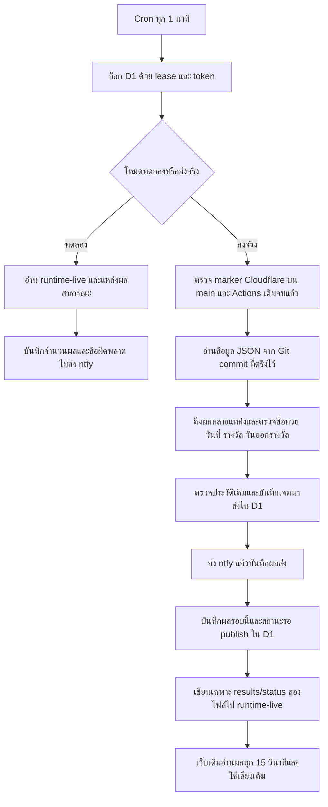

<!-- coderabbit-ai-generated:v1 -->

# Cloudflare Workers Free: ตรวจผลหวยทุกนาที

สถานะ ณ 7 พ.ย. 2026: Cloudflare Worker ติดตั้งจริงและตรวจผลใน `MODE=observe` ทุกนาทีแล้ว; **ยังไม่ส่ง ntfy** จนกว่าจะ Merge PR สลับตัวหลัก, Deploy โค้ดใหม่ และเปิด `MODE=deliver` หลังตรวจเงื่อนไข

## พิมพ์เขียว

- ตารางวันใช้ `data/draw_weekdays.json` เดิม รวมจันทร์–ศุกร์ วันศุกร์ และเสาร์–อาทิตย์ตามที่แต่ละรายการระบุ ไม่เดาวันหยุดตลาดหรือวันงวดพิเศษ
- ดึง ThaiLottoAPI, กลุ่มหุ้นจากผลหวย.com, ลาว EXTRA, 9 รอบจาก LotteryChecks และแหล่งรัฐบาลเดิม ต้องมีรางวัลบน/ล่างชัดเจน ไม่แต่งผล ไม่อนุมานเลขล่างจากเลขบน
- รางวัลรัฐบาลไทยต้องมีเลขรางวัลที่หนึ่งครบ 6 หลักและวันที่จริง จึงยืนยันงวดที่เลื่อนได้
- ประวัติชื่อหวย/วันที่/รางวัลเทียบกับ Python เดิมด้วย `tests/test_cloudflare_contract.py` และไม่ล้างประวัติการส่ง
- เมื่อ Merge PR สลับตัวหลัก `.github/workflows/lottery.yml` จะเหลือเฉพาะทดสอบใน PR ไม่รันตามเวลา ไม่ dispatch ไม่ส่ง ntfy และไม่เขียน runtime-live; Worker ตรวจ `cloudflare/PRIMARY_CHECKER.json` บน main ก่อนส่ง และตรวจว่ารอบ Actions เดิมทั้งหมดจบแล้ว
- D1 เก็บเฉพาะ ledger และผลที่เปลี่ยนในรอบ ไม่คัดลอกประวัติทั้งหมดลงแถวเดียว เมื่อ retry publish จะอ่านประวัติเดิมจาก immutable Git commit ช่วยหลีกเลี่ยงขนาดแถว D1 สูงสุด 2 MB
- ส่งได้สูงสุด 3 รายการต่อ invocation เพื่อเผื่อเพดาน subrequest ที่เหลืออยู่จะมีสถานะ queued และลองในรอบถัดไป ถ้าผลหลายรายการออกพร้อมกันอาจเพิ่มหลายรอบนาที ไม่รับประกันว่าจะถึงมือถือภายใน 60 วินาที

## แผนฟรีและเงื่อนไขก่อนเปิดจริง

ใช้บัญชี Workers Free และ D1 Free เท่านั้น ไม่มีโค้ดเปิด Workers Paid, R2, Queues, Containers หรือบริการเสียเงิน ต้องตรวจแผนในหน้า Billing ของบัญชีที่เลือกก่อนติดตั้ง หากบัญชีนั้นเป็น Paid อยู่แล้วให้หยุดและใช้บัญชี Free ตามที่เจ้าของเลือก

ข้อจำกัดอ้างอิงเอกสารวันที่ 7 พ.ย. 2026: Workers Free 100,000 requests/วันต่อบัญชี, CPU 10 ms/invocation และ 50 subrequests/invocation; Cron ทุกนาทีประมาณ 1,440 ครั้ง/วันก่อนรวม health/การเรียกอื่น D1 Free มี 5 ล้าน rows read/วัน, 100,000 rows written/วัน, 5 GB รวม และสูงสุด 50 binding queries/invocation โค้ดจำกัด external fetch ไม่เกิน 38 ครั้งต่อรอบ รวมการลองซ้ำ GET ของ GitHub ได้อีกไม่เกินหนึ่งครั้งต่อคำขอเมื่อเกิดเครือข่ายล้มเหลว หมดเวลา หรือ HTTP 502/503/504; ไม่ลองซ้ำคำขอเขียน GitHub, คำขอที่ถูกยกเลิกด้วย `AbortError` หรือการส่ง ntfy เพื่อป้องกันการส่งซ้ำ และมี D1 ไม่เกินประมาณ 12 ครั้งในรอบปกติ

**Build และการทดสอบในเครื่องไม่ยืนยัน CPU 10 ms บน Cloudflare** ต้องรันโหมด observe บนบัญชี Free และตรวจ CPU/subrequests/errors ใน Metrics หรือ `wrangler tail --format json` ทั้งรอบธรรมดาและรอบผลออกพร้อมกัน ก่อนเปลี่ยนเป็น deliver ถ้าเกินเพดานให้คง Actions และปรับแบ่งงานใน PR ถัดไป ห้ามแก้ด้วยการอัปเกรด Paid โดยไม่ได้รับอนุญาต การดึง HTML และประวัติที่โตขึ้นอาจทำให้เกิน CPU ในอนาคตได้

เมื่อชนโควตาฟรีอาจเกิด error/หยุดตรวจจนรีเซ็ต ไม่มีคำสั่งเปิดแผนเสียเงินจากระบบนี้ การใช้บริการอื่นหรือบัญชี Paid มีเงื่อนไขค่าบริการของตนเอง

อ้างอิง: [Workers limits](https://developers.cloudflare.com/workers/platform/limits/), [Workers pricing](https://developers.cloudflare.com/workers/platform/pricing/), [D1 limits](https://developers.cloudflare.com/d1/platform/limits/), [D1 pricing](https://developers.cloudflare.com/d1/platform/pricing/), [Cron](https://developers.cloudflare.com/workers/configuration/cron-triggers/)

## ติดตั้งหลังเจ้าของอนุมัติ PR นี้

ใช้ reviewed main ที่มีการแก้ครั้งนี้แล้ว ห้ามติดตั้งจาก runtime-live และห้ามนำ token ของ Coding Agent มาใช้เป็น runtime token

1. ใช้ Node 24/npm 11 แล้ว `cd cloudflare && npm ci` ตรวจว่าเป็นบัญชี Free: `npx --no-install wrangler login --device` และ `npx --no-install wrangler whoami` Device login ใช้ลิงก์กับรหัสชั่วคราว จึงอนุญาตจากมือถือได้โดยไม่ส่งรหัสผ่านในแชต
2. สร้าง D1 เพียงครั้งเดียว: `npx --no-install wrangler d1 create bombim00-lottery-state --location apac --update-config=false` ถ้ามีฐานเดิมให้ใช้ฐานเดิม ห้ามสร้างซ้ำหรือล้าง ledger
3. ใส่ UUID ที่ได้: `node configure.mjs <database_id> [account_id]` จะสร้าง `wrangler.local.json` ที่ไม่เข้า Git และยังหยุดทำงานอยู่
4. ใช้ `npx --no-install wrangler d1 migrations apply DB --remote --config wrangler.local.json` ห้ามรันไฟล์ migration ตรงเพื่อรีเซ็ตฐานที่มีข้อมูล
5. ติดตั้งตัวหยุดไว้ก่อน: `npx --no-install wrangler deploy --config wrangler.local.json`
6. เจ้าของสร้าง fine-grained GitHub PAT เฉพาะ `jirapatza/Bombim00`: Contents read/write และ Actions read จากนั้นใส่ผ่าน `npx --no-install wrangler secret put LOTTERY_RUNTIME_TOKEN --config wrangler.local.json` ใช้ token ที่เจ้าของสร้างเท่านั้น ไม่ส่งลงแชต ไม่ commit และไม่คัดลอกจาก credential ของ Coding Agent
7. ใส่ปลายทางเดิมผ่าน `npx --no-install wrangler secret put NTFY_TOPIC --config wrangler.local.json` ไม่ใช้ชื่อ topic สุ่มอัตโนมัติและไม่ส่งข้อความทดสอบโดยไม่ได้สั่ง ถ้ามี ntfy access token (ใช้ลิมิตสูงกว่าบน ntfy.sh หรือเซิร์ฟเวอร์ ntfy ของตัวเอง) ใส่เพิ่มเป็น `npx --no-install wrangler secret put NTFY_TOKEN --config wrangler.local.json` เป็นทางเลือก ไม่ใส่ก็ยังทำงานแบบเดิม (ไม่ล็อกอิน) เหมือนก่อนมี secret นี้
8. ใน local config เปลี่ยน `ENABLED` เป็นสตริง `true` คง `MODE=observe` แล้ว deploy ด้วย config เดิม ตัวเดิมยังทำงานตามปกติ ตรวจ `/health` และ Metrics/CPU/ข้อผิดพลาดจริงตาม gate ข้างต้น ครอบคลุมแหล่งที่สำคัญและช่วงผลออกพร้อมกัน ตรวจ Settings ของ runtime-live ว่าแหล่งที่ต้องการเปิดใช้งานจริง
9. เมื่อโหมดทดลองผ่านแล้ว Merge PR ที่ปิด schedule/dispatch/push ของ Actions และเพิ่ม `cloudflare/PRIMARY_CHECKER.json` บน main; รอรอบ Actions ที่กำลังทำงานทั้งหมดจบ หากมี Python worker ที่รันแยกนอก Actions ต้องหยุดก่อนด้วย (การแก้ workflow ไม่หยุด Python worker บนเครื่องอื่น)
10. เปลี่ยน local config เป็น `MODE=deliver` แล้ว deploy ตรวจ `/health`, GitHub runtime-live status/results, การยอมรับส่งจาก ntfy และให้เจ้าของยืนยันว่าโทรศัพท์ได้รับจริง การที่ ntfy HTTP200 ไม่พิสูจน์ว่าโทรศัพท์ได้รับหรือพูดเสียงไทยแล้ว

Cron ของ Cloudflare อาจใช้เวลาถึง 15 นาทีในการกระจายตารางครั้งแรก ผลในเว็บยังอาจช้าจากการเผยแพร่ raw GitHub/cache และเวลาอัปเดตของแหล่งต้นทาง

## เหตุขัดข้องที่ตรวจพบ 7 พ.ย. 2026 และเงื่อนไขสลับตัวรัน

- ตัวตั้งเวลา GitHub Actions ระบุทุก 5 นาที แต่รอบที่สังเกตจริงห่าง 40–61 นาที จึงไม่เหมาะเป็นตัวตรวจหลักที่ต้องการความเร็ว
- Cloudflare Worker ที่ติดตั้งจริงตั้ง `ENABLED=true`, `MODE=observe`, Cron ทุกนาที แต่ D1 แสดง `error=github_network`, `error_stage=snapshot` และยังไม่มี `lastObservation` หรือ `lastSuccess` จึง **ห้ามเปิด deliver หรือปิด Actions** จนตรวจสำเร็จจริง
- PR แก้การวินิจฉัยเพิ่มรหัสปลอดภัย เช่น `github_network_ref`, `github_timeout_contents` และ retry GET ที่ปลอดภัยหนึ่งครั้ง รหัสเหล่านี้บอกขั้นตอนที่ล้มเหลวเท่านั้น ไม่แสดง URL, token หรือข้อความ exception และไม่ยืนยันว่าต้นเหตุถูกแก้แล้ว
- หลัง Deploy PR ที่ได้รับอนุมัติ ให้รอ Cron และอ่าน D1 `worker_state` / `/health` จน `lastObservation.at` สดภายใน 5 นาทีและไม่มี error ติดต่อกันหลายรอบ รวมช่วงเวลาที่แหล่งผลออกจริง; ตรวจ Free CPU และจำนวน subrequests
- ก่อนสลับตัวส่งต้องมี `NTFY_TOPIC` เป็น secret ของ Worker, GitHub token สิทธิ์ Contents read/write และ Actions read, marker บน main ที่ตรงกับ workflow PR-only และไม่มี Actions checker ที่ยังทำงาน ตรวจ D1 ledger เพื่อไม่ส่งผลเดิมซ้ำ
- หลังเปิดส่งจริง ตรวจ ntfy HTTP acceptance, runtime-live status และการรับบน Android แยกกัน หากไม่ผ่านให้หยุด Worker อย่างปลอดภัยและย้อนกลับตามหัวข้อด้านล่าง **ห้ามเปิดสองตัวส่งพร้อมกัน**

## การสลับตัวส่งหลัก (PR หลัง #61)

การตัด GitHub Actions ออกจากการส่งจริงต้องทำเป็นลำดับ: Merge PR ที่ปิด Cron/dispatch/ntfy และเปลี่ยนเป็น PR tests อย่างเดียวก่อน; รอรอบ Actions เดิมจบ; Deploy Worker ที่อ่าน marker `cloudflare/PRIMARY_CHECKER.json` จาก `main`; ตรวจ `NTFY_TOPIC` secret และสถานะ D1; เปลี่ยน `MODE=deliver` เพียงตัวเดียว; ตรวจ runtime-live, ntfy HTTP acceptance และ Android receipt แยกกัน ถ้าข้อใดไม่ผ่านห้ามอ้างว่าแจ้งเตือนสำเร็จ

Cloudflare version 8 ใน `observe` อ่าน snapshot สำเร็จแล้วอย่างน้อยหนึ่งรอบ (14:30 UTC, 39 results, 22 scheduled, 1 source error) แต่การตรวจผ่านไม่ใช่หลักฐานว่า `deliver` ใช้งานได้ จึงต้องตรวจ writer/notification/publish เพิ่ม

## การตรวจสุขภาพและซ่อม

`GET /health` เป็น read-only ไม่เปิด endpoint สำหรับสั่งส่งหรือ reset สาธารณะ และไม่แสดง token/topic/ประวัติผลเต็ม คืน 503 เมื่อหยุด สถานะเก่า ค้าง publish หรือมีผลส่งไม่แน่นอน

- GitHub publish ล้มเหลว: รอบถัดไปใช้ผลเดิมใน D1 ลอง publish ก่อน ไม่ส่ง ntfy ซ้ำ และไม่ทับประวัติที่มีคนอื่นแก้
- ntfy ปฏิเสธแน่นอน เช่น 429: รอรอบถัดไปแล้วลองส่งรายการเดิมอีกครั้ง แม้ผู้ให้ข้อมูลไม่คืนรายการนั้นแล้ว
- timeout, 5xx หรือระบบหยุดระหว่างส่ง: เก็บ `uncertain` ไว้ ไม่เดาว่าส่งสำเร็จ ไม่ส่งรายการนั้นซ้ำอัตโนมัติ รายการอื่นตรวจต่อได้ ต่างจาก Python worker เดิมที่หยุดทั้ง process เมื่อมี inflight; หลักการป้องกันการส่งซ้ำยังคงอยู่
- ตรวจรายการที่ต้องพิสูจน์: `node recovery.mjs status` ใช้ local config และบัญชี Cloudflare ที่ได้รับอนุญาต
- ก่อนแก้สถานะให้ตั้ง `ENABLED=false` และ deploy รอ invocation/lease เดิมหมด ตรวจ ntfy history แล้วใช้ `node recovery.mjs resolve <id> sent "หลักฐาน ID ข้อความที่ ntfy รับแล้ว"` หรือ `failed` เฉพาะเมื่อมีหลักฐานว่าถูกปฏิเสธจริง คำสั่งไม่ส่ง ntfy และไม่ทำงานขณะมี lease หรือค้าง publish ห้ามลบฐานเพื่อให้ส่งใหม่ ห้ามใช้ sent เพื่อกลบ error
- ถ้ามี pending ให้เปิด deliver จน publish จบก่อนหยุด ถ้าเกิด runtime_conflict ต้องตรวจประวัติทั้งสองฝั่งก่อนแก้ ห้าม force-update runtime-live

## ย้อนกลับ

ตั้ง `ENABLED=false` และ deploy รอรอบที่เริ่มแล้วจบ ตรวจว่าไม่มี pending และพิสูจน์ uncertain ทุกตัวก่อน จากนั้นค่อยเปิด Actions checker เดิมกลับด้วย PR ที่เจ้าของอนุมัติ (คืน schedule/dispatch) หลังยืนยันว่า Cloudflare หยุดสนิท; การย้อนกลับไม่ใช่การเปิดตัวส่งทั้งสองพร้อมกัน เก็บ D1 ไว้เป็นหลักฐาน ห้ามเปิด Python/Actions/Cloudflare ส่งพร้อมกัน การสลับกลับอาจกลับมาช้าตาม scheduler ของ GitHub

## ทดสอบในเครื่อง

จาก root: `npm run lint && npm test && npm run build`, `python -m pytest tests/ -q`

จาก cloudflare: `npm ci`, `npm test`, `npm audit --audit-level=high`, `npm run build`, `npm run db:local`, `npm run dev -- --port 8787`

ในอีก terminal: `curl -i http://localhost:8787/health` ต้องคืน paused/503 ตามค่าเริ่มต้น แล้ว `curl 'http://localhost:8787/__scheduled?cron=*+*+*+*+*'` ต้องไม่เปลี่ยน ledger หรือส่งจริง Local workerd/D1 แยกจากฐาน production
