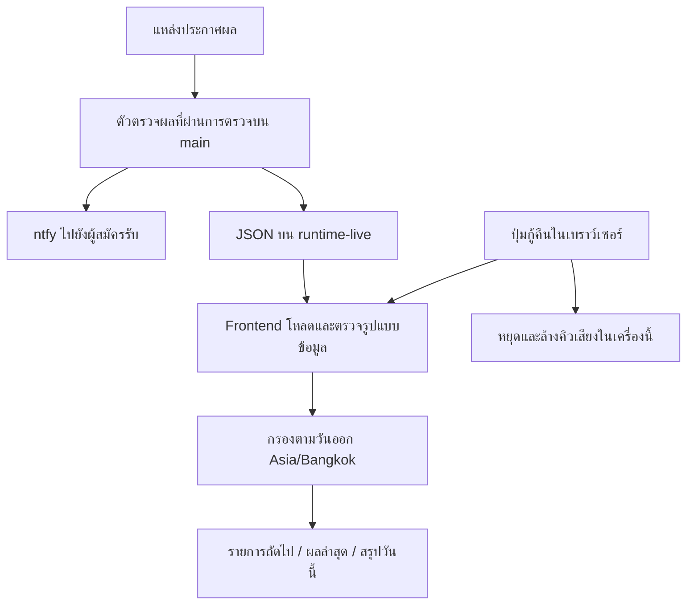

<!-- coderabbit-ai-generated:v1 -->

<!-- coderabbit-ai-generated-section:v1:e42f4d40e931b432767bb78acf93e21e7db0e2dfdac440cb5feaa7445ddef8bc -->

# พิมพ์เขียว BOMBIM00 — หน้าผลหวยและการกู้คืน

วันที่: 7 พฤศจิกายน 2569 • อ้างอิงภาพที่เจ้าของแนบในงานนี้

## เป้าหมายและขอบเขต

หน้าแรกเรียงรายการที่จะออกถัดไป → ตัวเลขสรุป → ผลล่าสุดสูงสุด 3 รายการ → ตารางสรุปประจำวัน ใช้โทนกรมท่า/น้ำเงินและสถานะเขียว/เหลืองตามภาพ รายการและผลใช้ข้อมูลจริง ไม่ใช้เลขในภาพเป็นข้อมูล ระบบตารางวันออกเดิมเป็นผู้คัดกรองรายการวันนี้ตาม Asia/Bangkok รวมถึงกฎศุกร์ วันธรรมดา และเสาร์–อาทิตย์

## โครงหน้า

- เดสก์ท็อป: เมนูด้านซ้ายและพื้นที่เนื้อหาด้านขวา
- มือถือ: เมนูล่าง คอลัมน์เดียว ตารางเลื่อนแนวนอนได้เฉพาะภายในกรอบ
- ส่วนหัว: วันเวลาไทย ปุ่มรีเฟรช สถานะโหลดข้อมูล และปุ่มเสียง
- รายการถัดไป: เลือกหวยที่ยังไม่ประกาศและเวลาออกวันนี้ยังไม่ถึง โดยเรียงเวลาออก ไม่ใช้เวลาปิดรับ นับถอยหลังจนถึงเวลาในตาราง
- ผลล่าสุด: เฉพาะผลที่ยืนยันของวันนี้ เรียงเวลาตรวจพบจากใหม่ไปเก่า หากไม่มีเวลาใช้เวลาออกตามตาราง และแสดงคำอธิบายไว้ หากตรวจพบเวลาเดียวกันใช้เวลาออกตามตารางตัดสินลำดับ แสดงไม่เกิน 3 รายการและไม่เติมผลเก่าให้ครบจำนวน
- ตาราง: กรองทั้งหมด/ประกาศผลแล้ว/กำลังรอผล/ยังไม่ถึงเวลา ค้นหาชื่อหรือเลข กรองประเภทและช่วงเวลา รีเซ็ตตัวกรอง เปิดรายละเอียด คัดลอก อ่าน และแชร์ผล
- สลากที่มีรางวัลที่ 1 แสดงเลขเต็มพร้อมชื่อรางวัล ไม่เรียกเลขเต็มว่า 3 ตัว
- ไม่มีรายการถัดไปหรือผลล่าสุด: แสดงสถานะว่างตามจริง ไม่มีผลสมมติ

## เส้นทางข้อมูล

เบราว์เซอร์โหลดข้อมูลทุก 15 วินาทีเมื่อมองเห็นหน้าและเมื่อกลับออนไลน์ แต่เวลาผลจริงยังขึ้นกับตัวตรวจฝั่งเซิร์ฟเวอร์ ผู้ให้ข้อมูล และแคช การเชื่อมต่อเว็บสำเร็จไม่ใช่หลักฐานว่าโทรศัพท์ได้รับ ntfy

## ปุ่มและพฤติกรรม

| ส่วน | ปุ่ม | ผลที่ต้องเกิด |
|---|---|---|
| เมนู | หน้าหลัก / ผลย้อนหลังและสถิติ / สรุปและแชร์ / ตรวจรางวัล / ตั้งค่า | เปลี่ยนหน้าภายในแอปและแสดงเมนูที่เลือก |
| หัวเว็บ | รีเฟรช | โหลดชุดข้อมูลล่าสุด ตรวจรูปแบบก่อนแทนที่ข้อมูลเดิม ปุ่มไม่รับคำสั่งซ้อน |
| หัวเว็บและตั้งค่า | เปิด/ปิดเสียง | ใช้ค่าเดียวกัน บันทึกในเครื่อง ปิดแล้วหยุดคิวเสียง |
| หน้าแรก | ตัวเลขสรุป / ดูทั้งหมด | เลื่อนไปตารางและตั้งตัวกรองที่ตรงกัน |
| รายละเอียด | อ่าน / คัดลอก / แชร์ / ปิด | อ่านด้วย TTS เดิม คัดลอกพร้อมรายงานผล แชร์ผ่านระบบหรือคัดลอกเป็นทางเลือก ปิดด้วยปุ่มหรือ Escape |
| สรุปและแชร์ | สร้างภาพ / คัดลอก / ดาวน์โหลด / แชร์ | ใช้เฉพาะผลที่ประกาศวันนี้ตามช่วงเวลาที่เลือก จัดการการยกเลิกแชร์และ fallback ดาวน์โหลด |
| ตรวจรางวัล | เลือกงวด / ตรวจ / ล้าง | ตรวจเฉพาะหวยและงวดที่เลือก ไม่ปนผลย้อนหลัง ล้างรายงานได้ |
| ตั้งค่า | เพิ่ม / ลบเลข | รับ 2, 3, 6 หลัก เน้นผลตรงในเครื่องนี้ รายงานเมื่อพื้นที่จัดเก็บใช้ไม่ได้ |
| ตั้งค่า ntfy | บันทึก | ตรวจ HTTP/HTTPS และชื่อ topic (คงรองรับเซิร์ฟเวอร์ส่วนตัวและ path prefix เดิม) ก่อนบันทึกเฉพาะในเบราว์เซอร์ ไม่เปลี่ยน secret หรือผู้ส่งจริง |
| อุปกรณ์ | ขอสิทธิ์ / ทดสอบแจ้งเตือน | ขอสิทธิ์และทดสอบเฉพาะเครื่องที่เปิดเว็บ ไม่เป็นการส่งผลหวยจริงหรือทดสอบ ntfy |
| กู้คืน | ซ่อมแซม / เชื่อมต่อใหม่ | หยุดเสียงค้าง โหลดข้อมูลใหม่ บอกสำเร็จ/ไม่สำเร็จ ไม่ลบข้อมูลหรือประวัติ |
| กู้คืน | หยุดเสียงค้าง | ยกเลิกคิว speech synthesis ในเครื่องนี้ |

## การฟื้นฟูและข้อจำกัด

เมื่อโหลดผิดพลาดจะเก็บข้อมูลล่าสุดที่มีอยู่ แสดงข้อความเตือน และลองใหม่ตามรอบปกติ เมื่อกลับออนไลน์จะโหลดใหม่ทันที ทุกครั้งต้องผ่านการตรวจ JSON ก่อนใช้แทนชุดเดิม ปุ่มกู้คืนเรียกเส้นทางเดียวกัน ไม่มีการล้างประวัติการส่งหรือส่ง ntfy ซ้ำ

การรีเซ็ตตัวกรองทำได้ทันที ส่วนการรีเซ็ตค่าโรงงาน ลบประวัติผล เปลี่ยน topic ของผู้ส่ง หรือรีสตาร์ต Render ไม่รวมในปุ่มนี้ ข้อมูลวินิจฉัยแยกเครือข่ายของเบราว์เซอร์ เวลาที่เว็บโหลดสำเร็จ และเวลาที่ตัวตรวจเซิร์ฟเวอร์ทำงานล่าสุด ไม่แสดงสถานะเขียวเพื่อกลบความล่าช้า

การควบคุมโทรศัพท์เครื่องอื่นจริงต้องมี backend ที่ยืนยันตัวตน ทะเบียนอุปกรณ์ การเพิกถอนสิทธิ์ และการตอบรับสถานะจากอุปกรณ์ ปัจจุบันเว็บ static ไม่มีองค์ประกอบเหล่านี้ จึงแสดงความสามารถเฉพาะอุปกรณ์ปัจจุบันอย่างชัดเจน ระบบเสียงภาษาไทยขึ้นกับเสียงและนโยบายเล่นเสียงของอุปกรณ์ ไม่มีการเปลี่ยนเสียงเดิม

## การตรวจรับและการเปิดใช้งาน

1. npm run lint, npm test, npm run build ต้องผ่าน
2. ทดสอบเดสก์ท็อปและมือถือ: ลำดับส่วน ปุ่มเมนู ตัวกรอง การค้นหา รายละเอียด และไม่มี overflow ทั้งหน้า
3. ทดสอบกรณีผลประกาศก่อนเวลา เวลาตามตารางมีคำว่า น. เวลาเท่ากัน ข้ามเที่ยงคืน และไม่มีผลวันนี้
4. ทดสอบข้อมูลโหลดไม่ได้แล้วกู้คืน การจัดเก็บถูกปิด การคัดลอก/แชร์ไม่พร้อม ต้องไม่แจ้งว่าสำเร็จ
5. ทดสอบเสียงและสิทธิ์แจ้งเตือนบนโทรศัพท์จริงก่อนยืนยันการรับแจ้งเตือน เพราะ cloud browser ยืนยันเสียงที่ผู้ใช้ได้ยินไม่ได้
6. เปิด PR ให้เจ้าของตรวจและอนุมัติก่อน merge/deploy หน้าใหม่ การย้อนกลับใช้ revert PR นี้ ไม่แตะ runtime-live หรือประวัติการแจ้งเตือน

## งาน production ที่ยังคงค้างจากระบบ realtime

ก่อนหน้านี้ PR #50/#51 ขึ้น main แล้ว แต่ worker ทุก 15 วินาทียังไม่ได้เปิด เพราะ Render/GitHub ต้องลงชื่อเข้าใช้และตั้ง secret/สิทธิ์ที่เหมาะสม ตัวส่งเดิมบน Actions ยังเป็นรอบ 5 นาที ห้ามเปิดตัวส่งสองตัวพร้อมกัน ต้องทำตาม docs/LOTTERY_SETUP.md แล้ววัดเวลาผลงวดจริงถึงโทรศัพท์ จึงถือว่าจบเป้าหมายแจ้งผล realtime การทำ UI รอบนี้ไม่แทนที่ขั้นตรวจรับนั้น

## ผลตรวจรอบพัฒนาหน้าใหม่

- lint / unit tests 17 ข้อ / production build ผ่าน และ npm audit ไม่พบช่องโหว่
- ทดสอบเบราว์เซอร์ 32 จุดบนเดสก์ท็อปผ่าน ครอบคลุมเมนู ตัวกรอง รายละเอียด การตั้งค่า เลขเฝ้าดู สรุปภาพ ตรวจรางวัล และการกู้คืน
- มือถือ 390 × 844: ทั้ง 5 หน้าไม่เกิดการเลื่อนแนวนอนทั้งหน้า หลังแก้ min-width ของหน้าตั้งค่า ตารางผลยังเลื่อนภายในกรอบได้
- ดาวน์โหลดรูปสรุปจริงและ fallback ของปุ่มแชร์บนเบราว์เซอร์ที่ไม่มี native share ได้ไฟล์ PNG 1080 × 1210
- กรณีพื้นที่จัดเก็บถูกปิดและโหลดข้อมูลล้มเหลวใช้การจำลองในเบราว์เซอร์เพื่อยืนยันข้อความผิดพลาด จากนั้นคืนการเชื่อมต่อและโหลดสำเร็จ
- ปุ่มคัดลอกผลทดสอบด้วยการคลิกจริงได้ข้อความสำเร็จ การทดสอบอัตโนมัติใช้ clipboard stub เสริม
- การอนุญาต/ปฏิเสธและปุ่มแจ้งเตือนในเครื่องทดสอบด้วย notification stub เท่านั้น Cloud browser มี permission เริ่มต้นและไม่มีเสียงติดตั้ง จึงยังไม่ยืนยันเสียงที่ผู้ใช้ได้ยินหรือการแจ้งเตือนที่โทรศัพท์จริง
- ยังไม่ merge/deploy หน้าใหม่ ต้องให้เจ้าของอนุมัติ PR ตาม AGENTS.md ก่อน และไม่ได้ส่ง ntfy จริง

<!-- /coderabbit-ai-generated:v1 -->